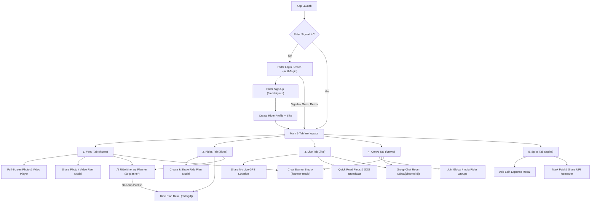

# RevCrew — Full App Flow & User Guide

This guide explains the complete end-to-end rider journey in **RevCrew** and how to use every feature in the mobile app.

---

## 1. End-to-End App Navigation Flow

---

## 2. Step-by-Step User Guide

### Step 1: Rider Login & Sign Up
1. Open **RevCrew** on your phone.
2. **New Riders:** Tap **Create Rider Account →** to enter your Full Name, `@handle`, Primary Motorcycle (e.g., *Himalayan 450*), Home City, Email, and Password.
3. **Existing Riders:** Enter your Email and Password and tap **Sign In to RevCrew**.
4. **Instant Preview:** Tap **Continue as Guest Rider (Instant Demo)** to explore all screens immediately.
5. To switch accounts or log out later, tap the **Sign Out** icon in the top-right corner of the **Feed** tab.

---

### Step 2: Community Feed (Photos & Video Reels)
- **View Photos & Videos:** Tap any photo or video reel card on the **Feed** tab to open the full-screen **Media Viewer** with native video playback, play/pause, mute/unmute, like, and share controls.
- **Upload Your Ride Media:** Tap the orange **`+`** button (or **+ Share Media**) to pick a photo or video from your gallery, add a caption, location, and hashtags, and publish it to the community feed.
- **Engage:** Tap the **Heart** to like, **Comment** to open the inline comment drawer, or **Share** to send to WhatsApp/Instagram.
- **Quick Studio Strip:** Jump straight to **AI Planner**, **Crew Banner**, or **Live Pack** from the top quick-action tiles.

---

### Step 3: Nearby Rides ("Open to Join") & Ride Plans
1. Switch to the **Rides** tab.
2. Filter rides by **All Rides**, **Near Me**, or **Global**, and toggle **Open to Join** to see only rides accepting new riders.
3. Each card displays distance from you, remaining open spots (`OPEN TO JOIN • 8 LEFT`), difficulty (`Chill / Spirited / Hardcore`), start time, and meetup point.
4. Tap **Join Ride** to RSVP immediately, tap the **Share** icon to invite friends, or tap the card to view full **Route Waypoints** and the **Pack Roster**.
5. **Create Your Own Ride Plan:** Tap **`+ Plan`** in the top-right corner, enter route details, meetup spot, max riders, and toggle **Open to Join** ON/OFF, then publish.

---

### Step 4: AI Ride Itinerary Planner
1. Open **AI Planner** from the **Feed** or **Rides** tab.
2. Choose a quick preset (e.g., *Chandigarh → Spiti Valley*, *Manali → Leh Ladakh*) or type any custom Origin & Destination.
3. Select **Duration (1–5 Days)**, **Riders Count**, **Riding Style**, and **Budget Tier**, then tap **Generate AI Ride Plan**.
4. Review the complete day-by-day itinerary including:
   - Rollout times & total km per day
   - Fuel pit stops, dhaba/cafe stops, scenic viewpoints & stay recommendations
   - Estimated cost per rider & pre-ride bike/gear checklist
5. Tap **Publish as Open Ride** to turn the itinerary into a live ride plan with one tap, or **Share** the full text itinerary with your group.

---

### Step 5: Live Location Sharing & Pack Radar
1. Switch to the **Live** tab during a group ride.
2. Toggle **Share My Live Location** ON to grant GPS access and broadcast your live position, speed (km/h), gap, and battery level to your pack.
3. Watch all active pack riders move in real time on the **Pack Radar Map**.
4. **Quick Pack Pings:** Tap **Fuel Stop**, **Chai Break**, **Hazard**, **All Clear**, or **Broadcast Emergency SOS Location** to alert every rider on the live map and in the ride's Group Chat simultaneously.

---

### Step 6: Global Groups, Group Chat & Crew Banner Studio
1. Switch to the **Crews** tab.
2. **Group Chats:** Tap any Ride Chat or Crew Chat to send messages, quick road pings, or share your live GPS coordinates directly in chat.
3. **Global Rider Groups:** Filter by **All**, **India**, or **Global** and tap **Join Group** to join regional or international riding chapters.
4. **Crew Group Banner Studio:** Tap **Crew Group Banner Studio** (or **Make Banner** on any crew card) to customize:
   - Layout format (`Poster Card` or `Wide Banner`)
   - Color theme & Crew Crest emblem (`Shield`, `Flame`, `Bolt`, `Compass`, `Wings`)
   - Crew Name, Tagline, City, Founded Year, and Ride Callout ribbon
   - Tap **Export & Share Crew Banner** to save/share the high-res PNG banner directly to WhatsApp or Instagram.

---

### Step 7: Split Payments
1. Switch to the **Splits** tab to see your live **Owed to You** vs. **You Owe** balances.
2. Tap **`+ Split`** to log a group expense (Fuel, Food & Chai, Tolls, Stay, or Gear/Repair) and select which riders are splitting the bill.
3. Tap any rider's **Mark Paid / Paid** pill to settle their share.
4. Tap **Remind** to share an itemized UPI payment summary directly to your ride's WhatsApp group.
