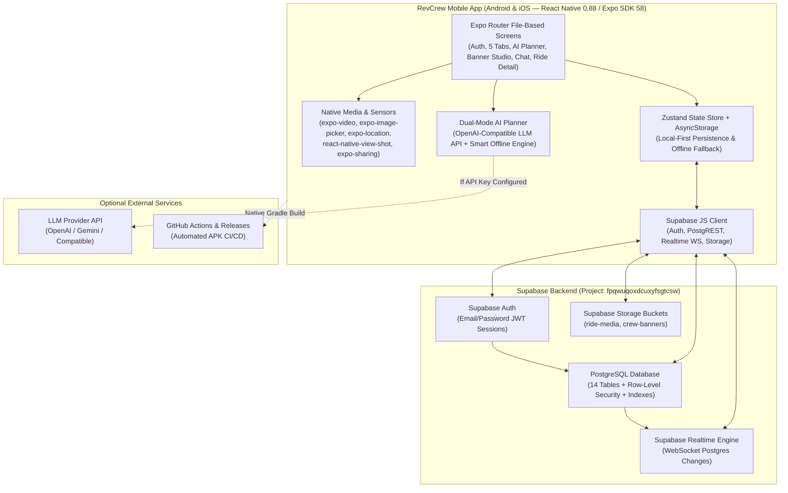
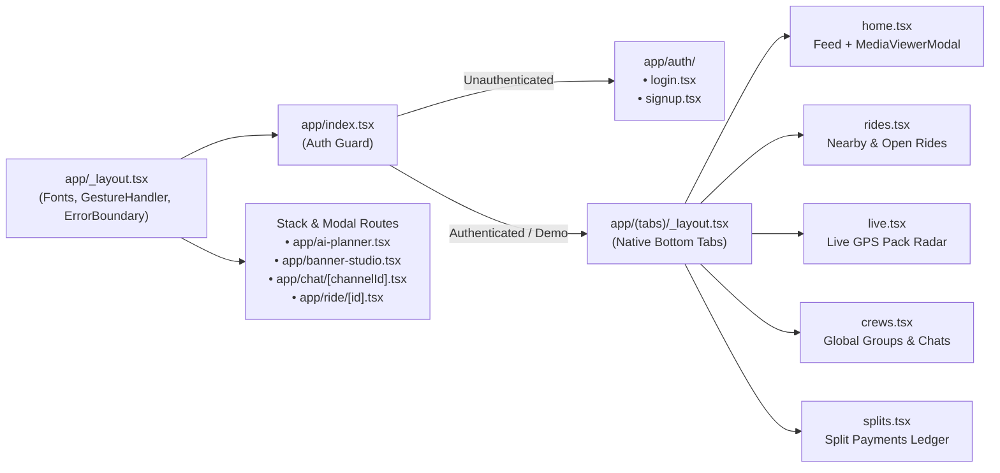
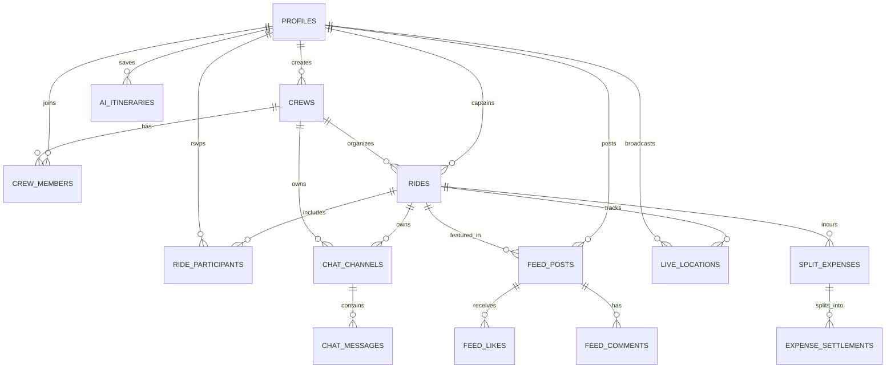
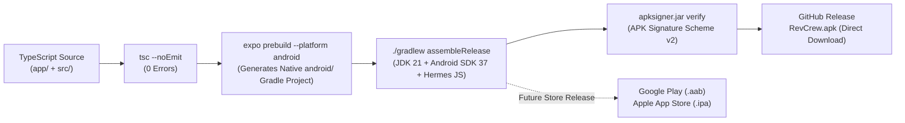

# RevCrew — System & Technical Architecture

This document describes the complete client, backend, real-time, storage, AI, and build/release architecture of **RevCrew**.

---

## 1. High-Level System Architecture

---

## 2. Client App Routing & State Architecture

### Key Client Design Decisions
- **Local-First Zustand + AsyncStorage (`src/store/useRevCrewStore.ts`)**: All rides, posts, chats, crew memberships, splits, and live telemetry work immediately offline and persist across app restarts.
- **Native Tab Navigation (`app/(tabs)/_layout.tsx`)**: Uses React Navigation's native `<Tabs>` bar for zero touch-clipping and reliable Android/iOS switching.
- **Error Boundary (`app/_layout.tsx`)**: Catches unexpected runtime errors cleanly with a dark recovery UI instead of hard-crashing.
- **Native Media Stack**:
  - `expo-video` (`VideoView` + `useVideoPlayer`) for hardware-accelerated video reel playback.
  - `expo-image-picker` for photo/video uploads from gallery.
  - `expo-location` for live GPS coordinates with simulated telemetry fallback on emulators.
  - `react-native-view-shot` + `expo-sharing` for high-resolution PNG Crew Banner export.

---

## 3. Supabase PostgreSQL Database Schema (ER Diagram)

All 14 tables live in the `public` schema with **Row-Level Security (RLS)** enabled and verified with **0 security advisor warnings**.

### Realtime & Storage Channels
- **Realtime (`supabase_realtime` publication):**
  - `public.chat_messages` → Instant group chat & road pings (`FUEL STOP`, `CHAI BREAK`, `HAZARD`, `ALL CLEAR`, `SOS`).
  - `public.live_locations` → Live rider GPS coordinates, speed (km/h), and battery % on the Pack Radar.
- **Storage Buckets:**
  - `ride-media` (public read, owner-scoped authenticated upload/update)
  - `crew-banners` (public read, owner-scoped authenticated upload/update)

---

## 4. Build, Signing & Release Pipeline

| Environment | Build Command | Output |
|---|---|---|
| **Local Android APK (No Expo Cloud)** | `android/gradlew -p android assembleRelease` | `RevCrew.apk` (arm64-v8a) |
| **GitHub Actions CI** | `.github/workflows/build-apk.yml` | Downloadable APK artifact on push |
| **Google Play Store (Future)** | `android/gradlew -p android bundleRelease` | `app-release.aab` |
| **Apple App Store (Future)** | `npx expo prebuild --platform ios` + Xcode Archive | `.ipa` via App Store Connect |
